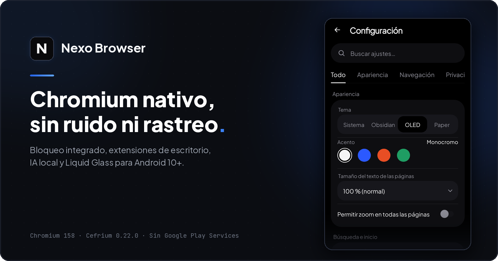
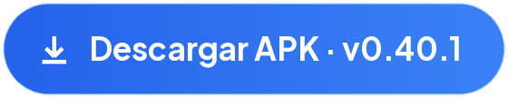
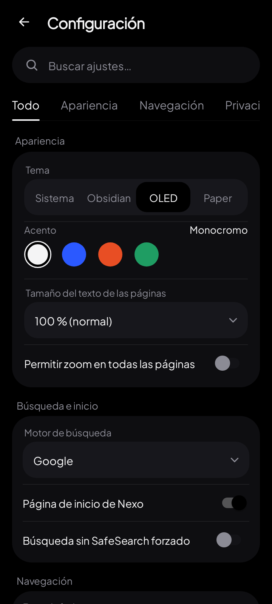
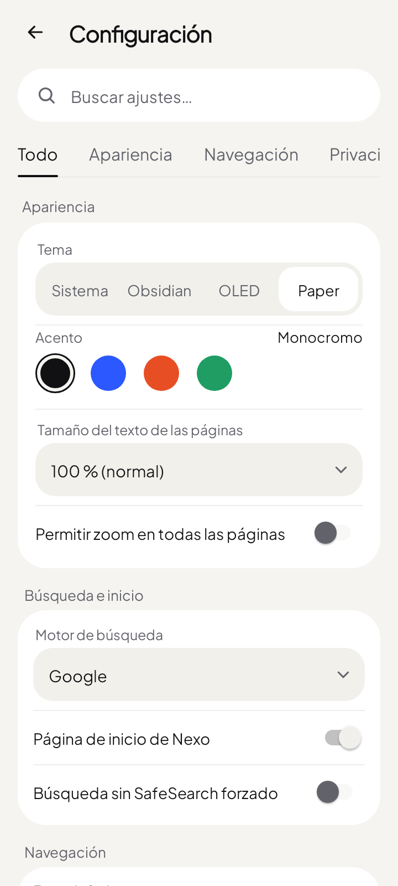

<div align="center">

<a href="#descargar">
  
</a>

<br /><br />

<p>
  <a href="https://github.com/stivencop-lab/Nexo-Browser/releases/tag/v0.40.1"></a>
  
  
  
</p>
<p>
  
  
  <a href="https://github.com/stivencop-lab/Nexo-Browser/actions/workflows/main.yml"></a>
  <a href="https://github.com/stivencop-lab/Nexo-Browser/issues"></a>
</p>

<br />

<a href="#descargar">
  
</a>

<br /><br />

<p><em>Navegador nativo para Android con Chromium 158 embebido, bloqueo integrado PhantomShield,<br />extensiones de escritorio NXR, Nexo AI e interfaz Liquid Glass — sin servicios de Google.</em></p>

<p>
  <a href="#descargar">Descargar</a> ·
  <a href="#novedades-en-v0401">Novedades</a> ·
  <a href="#primeros-pasos">Primeros pasos</a> ·
  <a href="#compatibilidad-de-extensiones">Extensiones</a> ·
  <a href="#desarrollo">Desarrollo</a> ·
  <a href="#licencias">Licencias</a>
</p>

</div>

---

## Nexo Browser

**Nexo Browser** es un navegador Android nativo (Kotlin + vistas Android) impulsado por **Chromium 158** embebido mediante **Cefrium 0.22.0**, libre de Google Play services, Firebase y ML Kit. Combina el bloqueo de red y cosmético de **PhantomShield**, pestañas privadas y **Burner** con perfiles aislados, **Nexo Reader** con lectura sin conexión, subtítulos en vivo, **Nexo AI** con control explícito de contexto y un **Extension Hub** con verificación CRX3 y reglas DNR estáticas, todo bajo el sistema visual **Liquid Glass**.

## Descargar

**Nexo Browser v0.40.1** · `versionCode 81` · Paquete `com.nexo.browser`

Los APK de esta sección corresponden a la publicación firmada `v0.40.1`.

| Dispositivo | Tamaño | APK firmado |
| --- | ---: | --- |
| Android ARM de 64 bits (`arm64-v8a`) | 115,2 MiB | [Descargar arm64-v8a](https://github.com/stivencop-lab/Nexo-Browser/releases/download/v0.40.1/Nexo-v0.40.1-arm64-v8a.apk) |
| Android ARM de 32 bits (`armeabi-v7a`) | 87,5 MiB | [Descargar armeabi-v7a](https://github.com/stivencop-lab/Nexo-Browser/releases/download/v0.40.1/Nexo-v0.40.1-armeabi-v7a.apk) |

Consulta la publicación completa y sus sumas verificadas: [Ver release v0.40.1](https://github.com/stivencop-lab/Nexo-Browser/releases/tag/v0.40.1) · [Descargar SHA256SUMS.txt](https://github.com/stivencop-lab/Nexo-Browser/releases/download/v0.40.1/SHA256SUMS.txt)

<details>
<summary>Elegir arquitectura y comprobar la integridad SHA-256</summary>

Comprueba las arquitecturas admitidas con el teléfono conectado por ADB:

```bash
adb shell getprop ro.product.cpu.abilist
```

Elige `arm64-v8a` si aparece en la lista; si el dispositivo es ARM de 32 bits, usa `armeabi-v7a`. Para verificar la descarga en Linux, guarda el APK junto a `SHA256SUMS.txt` y ejecuta:

```bash
sha256sum --ignore-missing -c SHA256SUMS.txt
```

Sumas SHA-256 oficiales de `v0.40.1`:

| APK | SHA-256 |
| --- | --- |
| `Nexo-v0.40.1-arm64-v8a.apk` | `fc362f813ff1f39e553b0dd21ae231b766e641abb0e138b58a8b8d01129261d9` |
| `Nexo-v0.40.1-armeabi-v7a.apk` | `d89883a2e0196f528c17016cbe26992c934770f534e592e99c6dcb1d7d5050af` |

Las actualizaciones conservan los datos siempre que se mantengan el paquete `com.nexo.browser`, el certificado de firma y un `versionCode` superior. [Firma y actualizaciones](docs/ACTUALIZACIONES-Y-FIRMA.md) · [Transferencia de perfil](docs/TRANSFERENCIA-PERFIL.md)

</details>

## Novedades en v0.40.1

| Área | Qué cambia |
| --- | --- |
| **Barra de direcciones, UI y Control del sitio** | Apertura de la barra de direcciones en 1 toque, optimizaciones de Liquid Glass, mejoras en Control del sitio y uso de APIs nativas de Cefrium 0.22.0 ([PR #86](https://github.com/stivencop-lab/Nexo-Browser/pull/86), [PR #87](https://github.com/stivencop-lab/Nexo-Browser/pull/87)). |
| **Subtítulos en vivo más fiables** | La captura web solicita fragmentos cada 125 ms, conserva el texto parcial mientras llega el definitivo, añade botón **Reintentar** y permite activar la detección de hablantes desde los ajustes ([Guía de subtítulos](docs/DIAGNOSTICO-SUBTITULOS.md)). |
| **Licencia Apache 2.0 y dependencias al día** | Adopción de **Apache License 2.0** ([PR #88](https://github.com/stivencop-lab/Nexo-Browser/pull/88)), actualización a Gradle `9.9.2`, AGP `9.5.3`, DataStore `1.3.0`, MaterialKolor `6.0.0`, Robolectric `4.18.1` y caché de CI. |
| **Chromium 158 · Cefrium 0.22.0** | Base de `v0.40` verificada por GPG y SHA-256 ([`cefrium-0.22.0.sha256`](gradle/cefrium-0.22.0.sha256)) con **0 clases** de Google Play services, Firebase ni ML Kit, puente `cefriumQuery` sin polling, selector nativo de archivos y Client Hints completos. |

El informe técnico documenta cada cambio respecto al issue `#84`, las pruebas ejecutadas y los **16 límites/problemas verificados** que aún persisten en Cefrium `0.22.0`: [Migración y límites de Cefrium 0.22.0](docs/CEFRIUM-0.22-MIGRACION-Y-LIMITES.md)

<p align="center">
  
  &nbsp;&nbsp;
  
</p>
<p align="center"><sub>Temas OLED y Paper · vistas nativas renderizadas con Robolectric en API 35.</sub></p>

## Primeros pasos

| Quiero… | Ejemplo |
| --- | --- |
| **Cambiar el tema y el cristal** | Abre **Configuración › Apariencia** y elige **Obsidian**, **OLED**, **Paper** o **Sistema**. En **Navegación › Intensidad del cristal**, prueba **Sutil**, **Equilibrado** o **Máximo Cristal**. |
| **Saltar a una pestaña abierta** | Escribe `@tabs android` en la barra de direcciones para buscar «android» entre tus pestañas y grupos. Las búsquedas con prefijo son 100 % locales. |
| **Leer sin conexión** | Abre un artículo, escribe `@actions lectura`, activa el modo lectura y pulsa **Guardar sin conexión**. Vuelve con `@actions sin conexion`. |
| **Ajustar permisos de un sitio** | Toca el icono junto al dominio para abrir **Control del sitio** (zoom, modo oscuro, escudo y permisos por sitio). |
| **Activar subtítulos** | Reproduce un video y toca **CC**. Nexo intenta mostrar la pista o el texto del reproductor. La transcripción de audio requiere una clave de Deepgram. [Subtítulos y diagnóstico](docs/DIAGNOSTICO-SUBTITULOS.md) |
| **Instalar una extensión con criterio** | Abre **Extensiones**, busca **uBlock Origin Lite** en Chrome Web Store y pulsa **Instalar en Nexo**. Revisa permisos, firma CRX3 y el veredicto del Hub antes de habilitarla. |

Nexo Command admite también `@history`, `@settings` y `@bookmarks`. Prueba `@settings tema` para abrir apariencia directo desde la barra de direcciones.

## Herramientas del navegador

| Función | Qué incluye |
| --- | --- |
| **Tabs Pro y Workspaces** | Vista en cuadrícula, compacta o lista, grupos de pestañas, detección de duplicados, pestañas fijadas, espacios de trabajo y favoritos con carpetas e importación/exportación HTML Netscape y JSON. |
| **Nexo Reader y traducción** | Lectura nativa con tipografía e interlineado ajustables, voz instalada en Android, archivo sin conexión (hasta 50 artículos o 10 MB) y traducción en página reversible. |
| **PhantomShield y Burner** | Bloqueo de red y cosmético, limpieza de parámetros de rastreo, excepciones por sitio, clasificación IA opcional aislada (`ShieldAiHost`) y pestañas **Burner** con perfil separado, proxy propio y correo temporal. [PhantomShield](docs/PHANTOMSHIELD.md) · [Grupos y Burner](docs/PESTANAS-RED-BURNER.md) |
| **Multimedia y subtítulos** | PiP, gestos en pantalla completa, velocidad, `MediaSession`, reproducción en segundo plano y subtítulos en vivo (pistas del vídeo, texto del reproductor o transcripción con Deepgram). [Diagnóstico de subtítulos](docs/DIAGNOSTICO-SUBTITULOS.md) |
| **Nexo AI 5.1** | Conversaciones persistentes, sesión minimizable en streaming, laboratorio para comparar modelos y firewall de contexto con permiso explícito. [Guía de Nexo AI](docs/NEXO-AI-5.1.md) |

## Compatibilidad de extensiones

El Hub acepta fichas de **Chrome Web Store** y **Edge Add-ons**, archivos locales `.crx`/`.zip`/`.xpi` y paquetes HTTPS directos. NXR verifica manifiesto, firmas CRX2/CRX3, continuidad de clave pública (`publicKeySha256`) y ampliaciones de permisos antes de instalar o actualizar.

| Capacidad | Alcance en v0.40.1 (Cefrium 0.22.0) |
| --- | --- |
| **CRX3 y manifiestos MV2/MV3** | Análisis del manifiesto, verificación criptográfica de firmas CRX3 y veredicto de compatibilidad antes de habilitar. |
| **Scripts, CSS y popups** | Ejecución de `content_scripts` declarados en sitios permitidos y popups/opciones en panel Cefrium con origen aislado por extensión. |
| **DNR estático** | Reglas estáticas admitidas de bloqueo y excepción evaluadas en PhantomShield (11.624 reglas admitidas en prueba JVM con uBlock Origin Lite). |
| **Limitado por el SDK** | Service Workers MV3 persistentes, mundos V8 aislados, reglas DNR dinámicas, `redirect` y `modifyHeaders`. |

Consulta la matriz completa de 20 APIs y el ejemplo de ruleset: [Nexo Extension Hub](docs/NEXO-EXTENSION-HUB.md)

## Desarrollo

Necesitas JDK 25, Node.js 20+ y la plataforma Android SDK `37.2`. Usa el wrapper de Gradle `9.9.2` del repositorio. La guía de compilación indica cómo instalar los paquetes del SDK y comprobar los APK. [Entorno local y CI](docs/CEFrium-CI-SETUP.md)

```bash
# Regresiones JavaScript
node --test app/src/test/js/*.test.cjs

# Pruebas JVM, APK de depuración y lint
./gradlew :app:testDebugUnitTest :app:assembleDebug :app:lintDebug

# Regresiones de temas y accesibilidad (Robolectric)
./gradlew :app:testDebugUnitTest -PnexoScreenshots \
  --tests '*UiThemeRegressionTest' --tests '*SkillPracticeRegressionTest'
```

<details>
<summary>Arquitectura, seguridad y publicación</summary>

| Componente | Entrada en el código |
| --- | --- |
| UI Kotlin/XML y Liquid Glass | `activity_main.xml`, `MainActivity`, `NexoTokens`, `NexoGlass`, `NexoGlassBackdrop`, `GlassPreferences` |
| Cefrium y ciclo de vida | `engine/cefrium/`, `CefriumEngineSession`, `CefResumeBridge`, `EngineDiagnostics`, `SpareRendererPool` |
| Pestañas y miniaturas | `TabManager`, `TabFreezeManager`, `TabPreviewStore`, `TabSwitcher` |
| NXR y privacidad | `extensions/hub/`, `extensions/nxr/`, `Crx3Parser`, `DnrBridge`, `shield/PhantomShield` |
| Puente asíncrono y herramientas | `PageBridge`, `PageChannel`, `assets/nexo/`, `reader/`, `workspace/`, `ai/` |

Nexo consume exclusivamente la API pública `com.cefrium.*` (el CI bloquea `org.chromium.*`, `org.jni_zero.*`, `GEN_JNI`, `addJavascriptInterface` y `.proceed()` en errores TLS). Las claves de proveedores se guardan cifradas con Android Keystore; historial, miniaturas y espacios de trabajo excluyen pestañas privadas.

**CI y firma.** GitHub Actions ejecuta regresiones JS y JVM, Robolectric, compilación debug/release, lint, verificación de reflexión R8 (`tools/check_release_reflection.py`, incluida `CefriumAppComponentFactory`) e identidad de paquete (`tools/check_apk_identity.py`). La compilación de release corre sin acceso a secretos y solo el paso de firma usa la clave persistente del proyecto. [Flujo de GitHub Actions](.github/workflows/main.yml) · [Firma y publicación](docs/ACTUALIZACIONES-Y-FIRMA.md)

</details>

## Licencias

El código propio de Nexo Browser se distribuye bajo **Apache License 2.0**. Cefrium, Dark Reader, las fuentes y las demás dependencias conservan sus licencias y avisos. [Apache License 2.0](LICENSE) · [Licencias y avisos de terceros](docs/LICENCIAS.md)

## Documentación

| Tema | Guías |
| --- | --- |
| **v0.40.0 y Cefrium 0.22.0** | [Migración y límites verificados de Cefrium 0.22.0](docs/CEFRIUM-0.22-MIGRACION-Y-LIMITES.md), [Extension Hub](docs/NEXO-EXTENSION-HUB.md), [Arquitectura de Chromium nativo](docs/CHROMIUM-NATIVE-MIGRATION.md) |
| **Interfaz y organización** | [Nexo UI 7.0 (referencia histórica)](docs/NEXO-UI-7.0-LIQUID-CRAFT.md), [Grupos, rutas y Burner](docs/PESTANAS-RED-BURNER.md) |
| **Navegación y multimedia** | [PhantomShield](docs/PHANTOMSHIELD.md), [Traducción en página](docs/TRADUCCION-EN-LINEA.md), [Audio y estabilidad](docs/ESTABILIDAD-Y-AUDIO-ANDROID.md), [Diagnóstico de subtítulos](docs/DIAGNOSTICO-SUBTITULOS.md) |
| **IA y datos** | [Nexo AI 5.1](docs/NEXO-AI-5.1.md), [Memoria IA local](docs/IA-MEMORIA.md), [Transferencia de perfil](docs/TRANSFERENCIA-PERFIL.md) |
| **Desarrollo y distribución** | [Entorno local y CI](docs/CEFrium-CI-SETUP.md), [Identidad Android](docs/IDENTIDAD-NEXO.md), [Actualizaciones y firma](docs/ACTUALIZACIONES-Y-FIRMA.md), [Licencias y avisos](docs/LICENCIAS.md) |

<details>
<summary>Historial de diseño y auditorías</summary>

[Auditoría v0.39.2](docs/AUDITORIA-0.39.2.md) · [Flow 4.0](docs/NEXO-FLOW-V4-IMPLEMENTATION.md) · [Diseño Flow 3.0](docs/NEXO-FLOW-V3-DESIGN.md) · [Validación V3](docs/NEXO-V3-IMPROVEMENTS.md) · [Auditoría V2](docs/AUDITORIA-ESTABILIDAD-OPTIMIZACION-V2.md) · [Auditoría UI 0.30.0](docs/AUDITORIA-UI-0.30.0.md) · [Auditoría Kotlin y PhantomShield](docs/AUDITORIA-BROWSER-SHIELD.md) · [Plan histórico WebView](docs/MIGRACION-CHROMIUM-WEBVIEW.md) · [Plan histórico Cefrium](docs/PLAN-TRABAJO-CHROMIUM.md)

</details>
