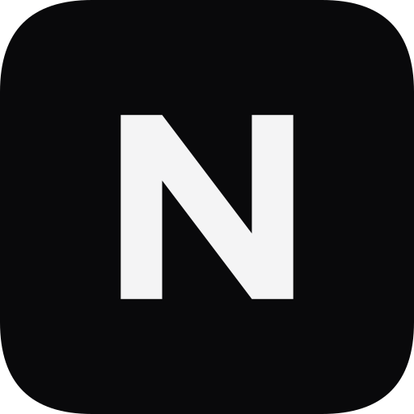

<div align="center">
  

  <h1>Nexo Browser</h1>
  <p>Navegador nativo para Android con Chromium, bloqueo integrado y herramientas para leer, buscar y organizar la web.</p>
  <p><strong>Liquid Glass</strong> · Android 10+ · Chromium 158 · Cefrium 0.22.0</p>
  <p><a href="#descargar">Descargar APK</a> · <a href="#primeros-pasos">Primeros pasos</a> · <a href="#compatibilidad-de-extensiones">Extensiones</a> · <a href="#desarrollo">Desarrollo</a></p>
</div>

## Descargar

Última versión publicada: **Nexo Browser v0.39.7** · `versionCode 79` · Paquete `com.nexo.browser` *(la migración a Chromium 158 / Cefrium 0.22.0 vive en el código fuente actual y se incluirá en la próxima release tras validación en dispositivo).*

| Dispositivo | Tamaño | APK firmado |
| --- | ---: | --- |
| Android ARM de 64 bits | 111,4 MiB | [Descargar arm64-v8a](https://github.com/stivencop414-bot/Nexo-Browser/releases/download/v0.39.7/Nexo-v0.39.7-arm64-v8a.apk) |
| Android ARM de 32 bits | 84,0 MiB | [Descargar armeabi-v7a](https://github.com/stivencop414-bot/Nexo-Browser/releases/download/v0.39.7/Nexo-v0.39.7-armeabi-v7a.apk) |

Puedes consultar la lista oficial de archivos y sus sumas. [Ver release v0.39.7](https://github.com/stivencop414-bot/Nexo-Browser/releases/tag/v0.39.7) · [Descargar SHA256SUMS.txt](https://github.com/stivencop414-bot/Nexo-Browser/releases/download/v0.39.7/SHA256SUMS.txt)

<details>
<summary>Elegir arquitectura y comprobar la descarga</summary>

Comprueba las arquitecturas admitidas con el teléfono conectado por ADB.

```bash
adb shell getprop ro.product.cpu.abilist
```

Elige `arm64-v8a` si aparece en la lista. Si el dispositivo admite ARM de 32 bits, usa `armeabi-v7a`. En Linux, guarda el APK y `SHA256SUMS.txt` en la misma carpeta para verificar la descarga.

```bash
sha256sum --ignore-missing -c SHA256SUMS.txt
```

Las sumas oficiales para `v0.39.7` son las siguientes.

| APK | SHA-256 |
| --- | --- |
| `Nexo-v0.39.7-arm64-v8a.apk` | `b8a818ebae49be61c43761872e40b7acec0e33f69c3c93248924f8eeb64630e1` |
| `Nexo-v0.39.7-armeabi-v7a.apk` | `7b4b7a7dba1c3fd87e150a9bc5982023d443040baa66a2e8a70436b2bbde35a3` |

Las actualizaciones conservan los datos cuando el APK mantiene el paquete y el certificado de firma y aumenta el `versionCode`. Consulta la ruta de importación si vienes del paquete anterior. [Firma y actualizaciones](docs/ACTUALIZACIONES-Y-FIRMA.md) · [Transferencia de perfil](docs/TRANSFERENCIA-PERFIL.md)

</details>

## Motor Chromium 158 y novedades recientes

| Área | Qué cambia |
| --- | --- |
| **Cefrium 0.22.0 (Chromium 158)** | Actualización verificada con GPG/SHA-256 (`gradle/cefrium-0.22.0.sha256`), sin dependencias de Google Play services, Firebase ni ML Kit. Aislamiento automático de procesos vía `CefriumAppComponentFactory`, `Cefrium.diagnostics(context)` en Ajustes › versión, Client Hints de escritorio (`CefriumUserAgentMetadata`) y selector nativo de archivos/cámara. |
| **PiP, foco y puente sin polling** | `MainActivity.onPause()` delega PiP a `browser.onPause()` (preservando audio en segundo plano cuando está activo), se retiraron los workarounds de foco sobre `EditText` y el puente `cefriumQuery` pasa a callbacks asíncronos aparcados (cero `setInterval`). Ver [migración y límites verificados de Cefrium 0.22.0](docs/CEFRIUM-0.22-MIGRACION-Y-LIMITES.md). |
| **Liquid Glass** | Isla de 56 dp y contador de pestañas separado sobre la página. Temas Obsidian, OLED y Paper. Intensidad de cristal ajustable y Dock Clásico disponible. |
| **Reanudación y memoria** | `CefResumeBridge` queda instrumentado con contadores `recoveries`/`watchdog` para confirmar en hardware real si `0.22.0` permite retirarlo. Las pestañas normales aptas se descartan tras cinco minutos de inactividad y las miniaturas se guardan en WebP. |
| **Extensiones de escritorio** | Verificación CRX3 multifirma, popups con viewport adaptable y origen por extensión, y reglas DNR estáticas evaluadas en el interceptor de PhantomShield. |

La auditoría histórica de `v0.39.2` y el informe técnico vigente de `Cefrium 0.22.0` detallan la validación automatizada y las pruebas pendientes en Android ARM. [Migración y límites de Cefrium 0.22.0](docs/CEFRIUM-0.22-MIGRACION-Y-LIMITES.md) · [Auditoría v0.39.2](docs/AUDITORIA-0.39.2.md)

<p align="center">
  
  
</p>
<p align="center"><sub>Configuración en Paper y OLED · vistas nativas renderizadas con Robolectric en API 35.</sub></p>

## Primeros pasos

| Quiero… | Ejemplo |
| --- | --- |
| **Cambiar el tema y la barra** | Abre **Configuración › Apariencia** y elige **Paper** para un fondo marfil. En **Navegación › Intensidad del cristal**, prueba **Sutil**, **Equilibrado** o **Máximo Cristal**. |
| **Volver a una pestaña abierta** | Escribe `@tabs android` en la barra de direcciones para buscar «android» entre tus pestañas y grupos. Las búsquedas con prefijo se procesan de forma local. |
| **Leer un artículo sin conexión** | Abre el artículo, escribe `@actions lectura` y elige **Activar modo lectura**. Pulsa **Guardar sin conexión** y vuelve al artículo con `@actions sin conexion`. |
| **Ajustar un sitio** | Toca el icono junto al dominio para abrir **Control del sitio**. Desde ahí puedes ajustar el zoom, el modo oscuro y los permisos del sitio. |
| **Revisar una extensión antes de activarla** | Abre **Extensiones**, busca **uBlock Origin Lite** en Chrome Web Store y pulsa **Instalar en Nexo** en su ficha. Revisa los permisos, la firma y el veredicto del Hub antes de habilitarla. |

Nexo Command ofrece también `@history`, `@settings` y `@bookmarks`. Prueba `@settings tema` para abrir el ajuste de apariencia desde la barra de direcciones.

## Herramientas del navegador

| Función | Uso |
| --- | --- |
| **Tabs Pro y Workspace** | Cambia entre cuadrícula, vista compacta y lista. Agrupa pestañas, detecta duplicados, fija páginas y guarda espacios de trabajo. Los favoritos admiten carpetas e importación o exportación en HTML Netscape y JSON. |
| **Nexo Reader y traducción** | Lee en una vista nativa, ajusta tipografía e interlineado, usa la voz instalada en Android y guarda hasta 50 artículos o 10 MB. Puedes traducir una página desde el menú y recuperar el original. |
| **PhantomShield y Burner** | Bloqueo de red y cosmético, limpieza de parámetros de rastreo y excepciones por sitio. Burner añade un perfil separado y correo temporal. [PhantomShield](docs/PHANTOMSHIELD.md) · [Grupos y Burner](docs/PESTANAS-RED-BURNER.md) |
| **Multimedia y subtítulos** | PiP, gestos en vídeo a pantalla completa, velocidad, MediaSession y reproducción en segundo plano. Los subtítulos en vivo admiten transcripción con Deepgram cuando Android permite capturar el audio. [Diagnóstico de subtítulos](docs/DIAGNOSTICO-SUBTITULOS.md) |
| **Nexo AI 5.1** | Conversaciones persistentes, sesión minimizable durante el streaming y laboratorio para comparar modelos. El contexto de página se comparte con permiso explícito. [Guía de Nexo AI](docs/NEXO-AI-5.1.md) |

## Compatibilidad de extensiones

El Hub acepta fichas de **Chrome Web Store** y **Edge Add-ons**, archivos locales CRX/ZIP/XPI y paquetes HTTPS directos. NXR revisa el manifiesto, las firmas, los permisos y la continuidad de clave antes de la instalación o actualización.

| Capacidad | Alcance actual (Cefrium 0.22.0) |
| --- | --- |
| **CRX3 y manifiestos MV2/MV3** | El instalador interpreta el manifiesto, verifica las firmas del CRX y ofrece un informe de compatibilidad. |
| **Scripts, CSS y popups** | NXR ejecuta scripts declarados en sitios permitidos y abre popups y opciones en un panel Cefrium con origen separado por extensión. El panel expone un conjunto limitado de APIs. |
| **DNR estático** | PhantomShield aplica reglas admitidas de bloqueo y excepción a subrecursos. La prueba JVM con uBlock Origin Lite admitió 11.624 reglas y bloqueó tres solicitudes de prueba. |
| **APIs pendientes** | Service Workers MV3 de extensión, Ports por marco, sincronización entre contextos, mundos V8 aislados, reglas DNR dinámicas, redirecciones y modificación de cabeceras. |

El veredicto del Hub describe las capacidades disponibles para cada paquete. Los permisos nuevos de una actualización requieren confirmación. [Guía del Hub, matriz y ejemplo de ruleset](docs/NEXO-EXTENSION-HUB.md)

## Desarrollo

**Requisitos** · JDK 25, Node.js 20+, Android SDK `platforms;android-37.2` y `build-tools;37.0.0`. El wrapper usa Gradle 9.8.2. La app se compila con SDK 37.2, `minSdk 29` y `targetSdk 35`. Cefrium se distribuye bajo LGPL-3.0-or-later y las huellas de sus dependencias están fijadas en el repositorio. [Huellas de Cefrium 0.22.0](gradle/cefrium-0.22.0.sha256) · [Configuración del CI de Cefrium](docs/CEFrium-CI-SETUP.md)

```bash
# Regresiones JavaScript
node --test app/src/test/js/*.test.cjs

# APK de depuración, pruebas JVM y lint
./gradlew :app:testDebugUnitTest :app:assembleDebug :app:lintDebug

# Temas y accesibilidad con Robolectric
./gradlew :app:testDebugUnitTest -PnexoScreenshots \
  --tests '*UiThemeRegressionTest' --tests '*SkillPracticeRegressionTest'
```

<details>
<summary>Arquitectura, seguridad y publicación</summary>

| Componente | Entrada en el código |
| --- | --- |
| UI Kotlin/XML y material | `activity_main.xml`, `MainActivity`, `NexoTokens`, `NexoGlass`, `NexoGlassBackdrop`, `GlassPreferences` |
| Cefrium y ciclo de vida | `engine/cefrium/`, `CefResumeBridge`, `CefriumEngineSession`, `EngineDiagnostics`, `SpareRendererPool` |
| Pestañas y miniaturas | `TabManager`, `TabFreezeManager`, `TabPreviewStore`, `TabSwitcher` |
| NXR y privacidad | `extensions/hub/`, `extensions/nxr/`, `Crx3Parser`, `DnrBridge`, `shield/PhantomShield` |
| Herramientas de página | `PageBridge`, `PageChannel`, `assets/nexo/`, `reader/`, `workspace/`, `ai/` |

La integración consume solo la API pública `com.cefrium.*`. Las claves de proveedores se almacenan con Android Keystore. El historial, las miniaturas y los espacios de trabajo excluyen las pestañas privadas. [Arquitectura de Chromium nativo](docs/CHROMIUM-NATIVE-MIGRATION.md) · [Migración y límites de Cefrium 0.22.0](docs/CEFRIUM-0.22-MIGRACION-Y-LIMITES.md)

**CI y firma.** GitHub Actions ejecuta regresiones JavaScript y JVM, pruebas Robolectric, compilación, lint y verificación de reflexión R8 (`tools/check_release_reflection.py`, incluida `CefriumAppComponentFactory`). El flujo de release verifica la identidad del APK y el certificado de firma antes de publicar los dos APK y su archivo de sumas. Los secretos se usan en el paso de firma. [Flujo de GitHub Actions](.github/workflows/main.yml) · [Firma y publicación](docs/ACTUALIZACIONES-Y-FIRMA.md)

</details>

## Documentación

| Tema | Guías |
| --- | --- |
| **Cefrium 0.22.0 y estado** | [Migración y límites verificados de Cefrium 0.22.0](docs/CEFRIUM-0.22-MIGRACION-Y-LIMITES.md), [Extension Hub](docs/NEXO-EXTENSION-HUB.md), [Auditoría v0.39.2](docs/AUDITORIA-0.39.2.md) |
| **Interfaz y organización** | [Nexo UI 7.0, referencia histórica](docs/NEXO-UI-7.0-LIQUID-CRAFT.md), [Grupos, rutas y Burner](docs/PESTANAS-RED-BURNER.md) |
| **Navegación y multimedia** | [PhantomShield](docs/PHANTOMSHIELD.md), [Traducción en página](docs/TRADUCCION-EN-LINEA.md), [Audio y estabilidad](docs/ESTABILIDAD-Y-AUDIO-ANDROID.md) |
| **IA y datos** | [Nexo AI 5.1](docs/NEXO-AI-5.1.md), [Memoria IA local](docs/IA-MEMORIA.md), [Transferencia de perfil](docs/TRANSFERENCIA-PERFIL.md) |
| **Desarrollo y distribución** | [Migración a Chromium](docs/CHROMIUM-NATIVE-MIGRATION.md), [Configuración del CI](docs/CEFrium-CI-SETUP.md), [Identidad Android](docs/IDENTIDAD-NEXO.md), [Actualizaciones y firma](docs/ACTUALIZACIONES-Y-FIRMA.md) |

<details>
<summary>Historial de diseño y auditorías</summary>

[Flow 4.0](docs/NEXO-FLOW-V4-IMPLEMENTATION.md) · [Diseño Flow 3.0](docs/NEXO-FLOW-V3-DESIGN.md) · [Validación V3](docs/NEXO-V3-IMPROVEMENTS.md) · [Auditoría V2](docs/AUDITORIA-ESTABILIDAD-OPTIMIZACION-V2.md) · [Auditoría UI 0.30.0](docs/AUDITORIA-UI-0.30.0.md) · [Auditoría Kotlin y PhantomShield](docs/AUDITORIA-BROWSER-SHIELD.md) · [Plan histórico WebView](docs/MIGRACION-CHROMIUM-WEBVIEW.md) · [Plan histórico Cefrium](docs/PLAN-TRABAJO-CHROMIUM.md)

</details>
